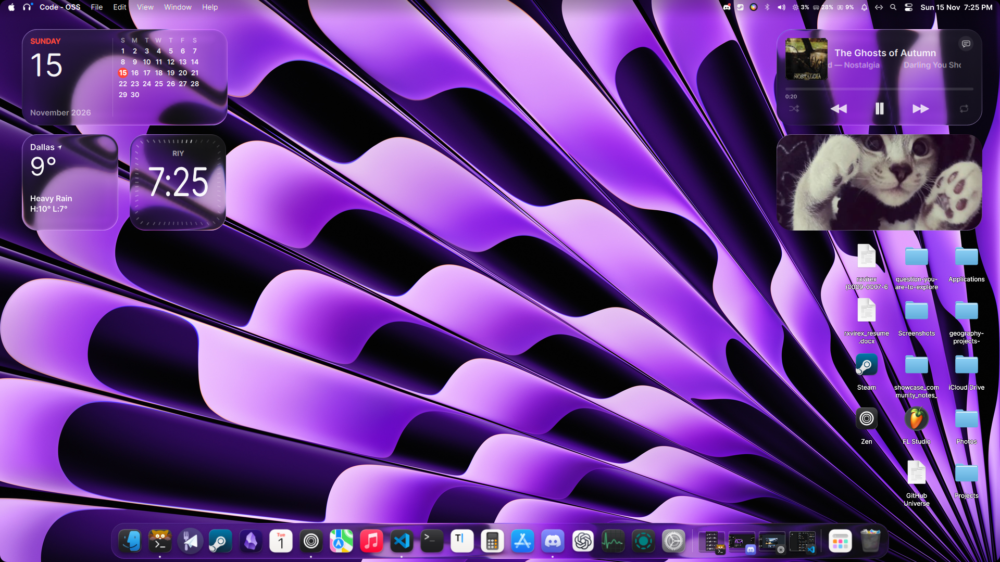
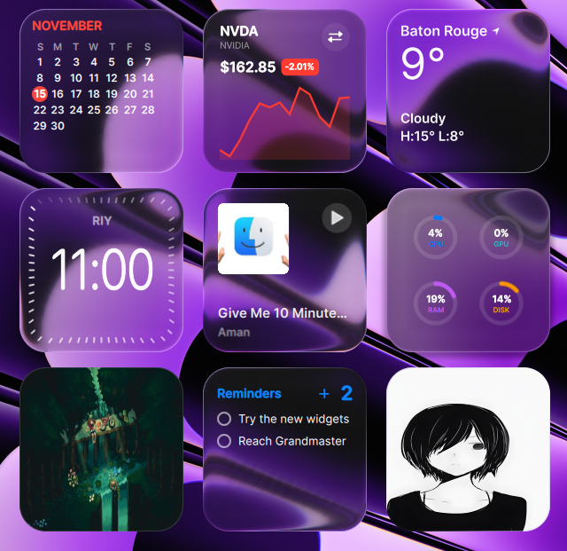
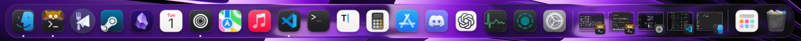
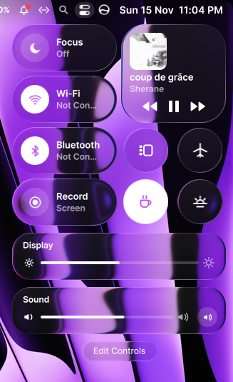
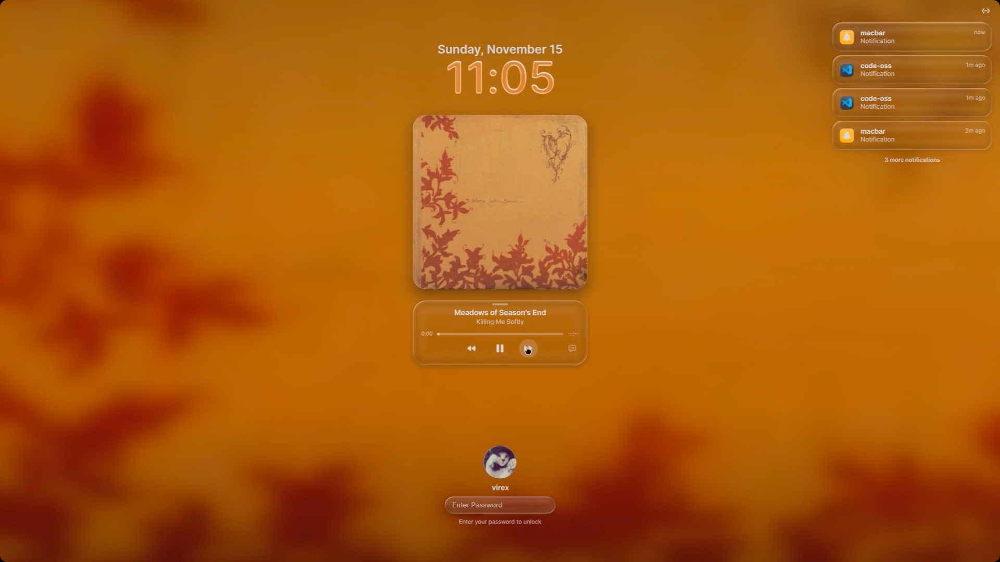
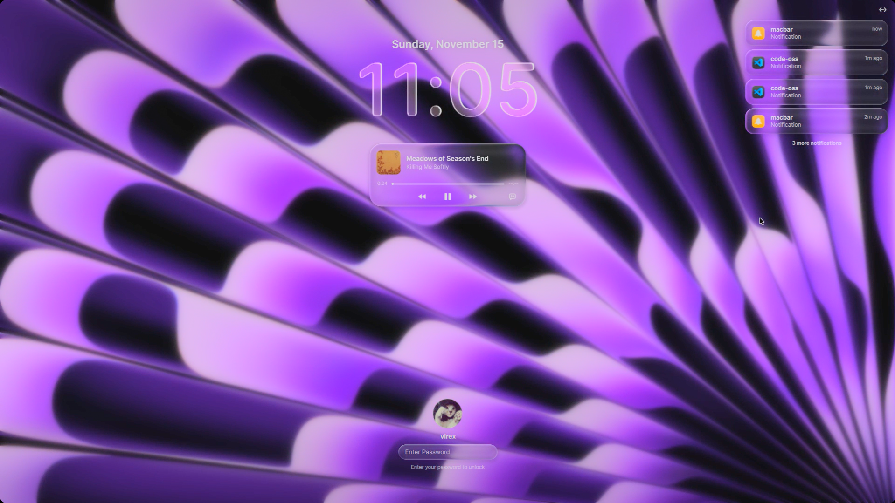

<p align="center">
  
</p>

<p align="center">
  A MacOS 27 styled <b>quickshell configuration</b> for Hyprland</a>,<br>
  with real-time <b>Liquid Glass</b> refraction shading, and a lock screen, <b>shell27-lock</b>.
</p>

---

### One-line Quick Install

Run the following command on Arch Linux (inside an active Hyprland session) to open the shell27 installer:

```bash
sh -c "$(curl -fsSL https://raw.githubusercontent.com/hnpf/shell27/main/install.sh)"
```

> If you decline the optional SDDM theme, a first install only adds Quickshell and the core Qt runtime needed to open the GUI. The installer appears over a black background on its **Dependencies** page; install the full dependency set there before installing shell27.

> On Arch, the installer also offers the optional [MacTahoe SDDM theme](https://github.com/hnpf/MacTahoe-SDDM-Theme). Accepting installs its prerequisites and runs the theme's installer, which configures SDDM and may offer to enable its service.

> The installer also offers the [MacTahoe icon theme](https://github.com/vinceliuice/MacTahoe-icon-theme) and [MacTahoe GTK theme](https://github.com/vinceliuice/MacTahoe-gtk-theme). These are installed for the current user; changing the active GTK or icon settings remains a separate desktop setting.

> shell27’s first-run welcome lets you choose a starting appearance and accent. Reopen it with `qs -c shell27 ipc call welcome open`; reset it with `qs -c shell27 ipc call welcome reset`. Update tools can show the update welcome with `qs -c shell27 ipc call welcome update <version>`.

> Apple Color Emoji is downloaded during installation from the pinned [macOS 26 Linux font release](https://github.com/samuelngs/apple-emoji-ttf/releases/tag/macos-26-20260722-484daf4e) and checksum-verified; the 110 MB font is not stored in this Git repository. The upstream project states its MIT license does not cover Apple emoji assets and notes that use may have licensing implications. You are responsible for ensuring your use is permitted. To use another authorized copy, set `SHELL27_APPLE_EMOJI_PATH` or override `SHELL27_APPLE_EMOJI_URL` and `SHELL27_APPLE_EMOJI_SHA256`.

---

### Repository Layout

- `hyprland/`: personal Hyprland Lua config and its Genie helper.
- `settings/`: sanitized starter settings; API keys and machine-specific wallpaper/image paths are blank.
- `gtk-3.0/` and `gtk-4.0/`: GTK appearance settings installed to `~/.config` by `install.sh`.
- `hypr-shell27/`: Hyprland helper scripts and session files.
- `shell27/`: desktop shell Quickshell config.
- `shell27-lock/`: independent lock-screen Quickshell config.
- `shell27-installer/`: graphical installer UI.
- `install.sh`: dependency-aware installer and updater.
- `LICENSE`: unchanged upstream MIT license.

---

<h1 align="center">Showcase</h1>

<p align="center">
  
  <br>
  <sub>Quick showcase</sub>
</p>

<p align="center">
  <a href="#screenshots">Screenshots</a> ·
  <a href="#requirements">Requirements</a> ·
  <a href="#install">Install</a> ·
  <a href="#updating">Updating</a> ·
  <a href="#hyprland-configuration-lua">Hyprland config</a> ·
  <a href="#shell27-lock">shell27-lock</a> ·
  <a href="#troubleshooting">Troubleshooting</a>
</p>

---

A MacOS 27 styled **quickshell configuration** for Hyprland, with real-time
"Liquid Glass" refraction shading, window previews, Spotlight, clipboard/emoji picker, notifications, Control Center,
screenshots, screen recording, an extended suite of desktop widgets (weather, calendar, clock, music player with synchronized lyrics, animated GIF/WebP, system monitor, stocks/crypto, battery, reminders), a wallpaper picker, an
Alt+Tab switcher, and a full lock screen, all in one Quickshell process.

The repository also ships **shell27-lock**, a matching Liquid Glass lock screen with **Apple Music Motion Artwork** and **Spotify Canvas** video playback, synchronized karaoke lyrics, and PAM security.

Best icon pack for the shell: https://github.com/Scrimas/MacOS-Like

> **Heads up:** this targets **Hyprland 0.55+ with a Lua config** (`hyprland.lua`) and a recent **Quickshell (0.3.x)**.
> See [Requirements](#requirements) and [Known issues](#known-issues).

## Fork Features & Enhancements

This fork extends upstream shell27 with multimedia features, desktop widgets, and GPU optimizations:

### Animated Album Canvas on shell27-lock (Apple Music Motion & Spotify Canvas)
- **Official Apple Music Motion Artwork**: Integrates Apple Music's modern AMP API (`amp-api.music.apple.com`) to retrieve official animated album motion videos (`motionDetailSquare` / `motionDetailTall`).
- **Official Spotify Canvas**: Automatically queries and fetches Spotify Canvas videos for currently playing tracks.
- **Zero-CPU Video Remuxing**: Uses pure stream-copy remuxing (`ffmpeg -c copy`) to convert HLS streams to `.mp4` in milliseconds with **0% CPU transcoding overhead**.
- **Smart 20 MB Cache Protection**: Automatic LRU cache pruner prevents disk bloat by enforcing a strict 20 MB / 4-video limit.
- **Smooth Fallback**: Gracefully fades into high-resolution blurred album artwork when no animated video exists.

### Synchronized Apple Music-Style Lyrics
- **Word-by-Word Karaoke Illumination**: Lyrics illuminate and scale smoothly as each word is sung.
- **Instrumental Break Indicator**: Displays 3 pulsing / breathing rhythm indicator dots during musical interludes.
- **Depth-of-Field Blur**: Off-focus lines blur and scale down gently; active lines smoothly bounce into focus (`Easing.OutBack`).
- **Available Everywhere**: Seamlessly integrated into both **shell27-lock** and the **Shell27 Player desktop widget**.
- **Multi-Source Fetcher (`lyrics_fetcher.py`)**: Asynchronously queries LRCLIB with fallback to `syncedlyrics` (Musixmatch, NetEase, Megalobiz).

### Extended Desktop Widgets Suite
- **Animated GIF / WebP Widget (`GifWidget.qml`)**: Display looping animations directly on the desktop with macOS squircle aesthetics and an interactive file picker.
- **System Monitor Widget (`SystemMonitorWidget.qml` & `sysmon_reader.py`)**: macOS Activity Monitor-style circular gauges for CPU, GPU, RAM, Disk, Thermals, and Network.
- **Stocks & Cryptocurrency Widget (`StocksWidget.qml` & `stocks_fetcher.py`)**: Live market tracking (BTC, ETH, SOL, AAPL, NVDA, etc.) with interactive sparkline curves and gradient fills.
- **Battery Widget (`BatteryWidget.qml` & `battery_reader.py`)**: Displays battery percentage, health, and power profile.
- **Reminders Widget (`RemindersWidget.qml` & `Reminders.qml`)**: Interactive task checklist that syncs with `reminders.md` and plays Apple sound effects.
- **AirDrop-style sharing (`AirDrop.qml` & `assets/shell27-airdrop.py`)**: Discovers LocalSend-compatible devices, asks before receiving, and saves accepted files to `~/Downloads`.
- **First-run welcome (`SetupAssistant.qml`)**: Offers appearance and accent choices and links to System Settings. It does not install packages or alter network settings. Reopen with `qs -c shell27 ipc call welcome open`.

### Heavy GPU & CPU Optimizations (macOS App Nap)
- **Desktop Occlusion Awareness**: Animated widgets (GIF, Canvas, Lyrics) detect when they are covered by application windows. Playback and decoders pause automatically, dropping idle resource usage to **0%**.
- **Streamlined Liquid Glass Shader**: Downsampled blur pre-passes (`gl.ds = 0.5`) and settle timers eliminate continuous redraw loops.

### Apple Intelligence, Visual Intelligence, and Siri Voice Assistant
- **Apple Intelligence Edge Glow Waves**: Fullscreen multi-tier chromatic liquid light bloom (`siriedgeglow.frag`) along all 4 display borders with pure translucent neon emission, subtle micro-ripples, and zero black edge halos.
- **Dynamic Fluid Siri Orb (`SiriOrb.qml`)**: Fluid plasma sphere icon with noise-driven organic turbulence, breathing with your voice.
- **Smart On-Demand Voice Interaction**: Instant voice awake via `SUPER + Space` with automatic mic shutdown right after processing.
- **Studio-Quality Neural Text-to-Speech**: Built-in Microsoft Edge Neural TTS (`edge-tts`) delivers lifelike, crystal-clear vocal responses without robotic buzz. Features single-speaker mutex to prevent overlapping audio.
- **Gemini AI 2.5 Flash / Pro Integration**: Natural conversational intelligence, live weather syntheses (`wttr.in`), and intelligent multi-step application launcher (Flatpak, Desktop files, Hyprland exec).
- **Type to Siri Floating Capsule (`TypeToSiri.qml`)**: macOS Sequoia-style floating search capsule with auto-dismissal, history, and keyboard navigation.

---

## Setting Up Apple Intelligence & Siri

shell27 comes with on-device Apple Intelligence powered by Google's Gemini generative AI engine.

### 1. Get a Free Gemini API Key
1. Go to [Google AI Studio](https://aistudio.google.com).
2. Sign in with your Google account and click **Get API key** -> **Create API key**.
3. Copy your generated key.

### 2. Configure the API Key in shell27
You can configure your API key in either of two ways:
- **Via Graphical Settings (Recommended)**:
  1. Open **System Settings** from the Apple Menu or Dock.
  2. Select the **Apple Intelligence & Siri** panel.
  3. Paste your key into the **Gemini API Key** field and click **Test Key**.
- **Via Configuration File**:
  Edit `~/.config/quickshell/shell27/gemini_config.json`:
  ```json
  {
    "api_key": "YOUR_GEMINI_API_KEY_HERE",
    "model": "gemini-2.5-flash"
  }
  ```

The installer provisions the Gemini Python client in an isolated environment. Rerun `./install.sh` on an older install to add it.

### 3. Siri Voice Assistant Usage & Keybindings
| Action | Keybinding / Trigger | Description |
|---|---|---|
| **Voice Siri** | `SUPER + Space` | Activates on-demand voice listening. Siri records, responds, speaks aloud, and auto-dismisses. |
| **Type to Siri** | Click Menu Bar / Dock icon, or press `Space` during voice mode | Opens the floating Type to Siri capsule. |
| **Dismiss / Silence** | `Esc` | Instantly dismisses Siri and cuts off any currently playing speech. |

### 4. Language & Voices
- **Languages Supported**: English (`en-US`, default) and Vietnamese (`vi-VN`).
- **Neural Voice Options**:
  - English: *Jenny* (Female), *Guy* (Male), *Sonia* (British).
  - Vietnamese: *Hoài My* (Female), *Nam Minh* (Male).
- **Speech Rate**: Fully adjustable from 130 WPM to 220 WPM in Settings with an instant **Test Voice** preview button.

## Screenshots

### shell27

**The whole desktop:** widgets, the menu bar on top and the Dock at the bottom.

<p align="center">
  
</p>

<p align="center">
  

</p>

**The Dock,** with Liquid Glass.

<p align="center">
  
</p>

**Control Center (New)**

<p align="center">
  
</p>

### shell27-lock

<table align="center">
  <tr>
    <td align="center" width="50%">
      
      <br>
      <sub>Lock screen</sub>
    </td>
    <td align="center" width="50%">
      
      <br>
      <sub>Lock screen media player</sub>
          <td align="center" width="50%">
    </td>
  </tr>
</table>

## Files

hyprland/       personal Hyprland config and Genie helper
settings/       sanitized starter shell settings
hypr-shell27/   Hyprland helper scripts and session files
          This fork extends the upstream `hnpf/shell27` with powerful new capabilities, multimedia features, and GPU optimizations:
shell27-lock/   lock Quickshell config -> ~/.config/quickshell/shell27-lock
shell27-installer/ graphical installer UI
install.sh      installer and updater
README.md       project documentation
LICENSE         upstream MIT license, unchanged
```

The two Quickshell configs are installed separately. The starter settings in `settings/` contain no API credentials or personal image paths; copy only the settings you want into their documented user config locations.

**shell27**

| File | Purpose |
|---|---|
| `shell.qml` | Entry point. Shared hub: window geometry, wallpaper lookup, capture gating. |
| `MacBar.qml` | Menu bar, Control Center, Spotlight, notifications, switcher, screenshots, wallpaper picker. |
| `MacDock.qml` | Dock, window previews, and the Settings window. |
| `ClockApp.qml` | The Clock app window (opened from the menu bar clock). |
| `MacWidgets.qml` | Desktop widgets layer (data, placement, editing). |
| `WidgetVisual.qml` | Draws one widget; shared by the desktop layer and the Liquid Glass backdrop, so menus refract the widgets too. |
| `WeatherWidget.qml`, `CalendarWidget.qml`, `ClockWidget.qml`, `PlayerWidget.qml`, `ImageWidget.qml` | Core desktop widgets (`PlayerWidget.qml` includes synchronized karaoke lyrics and pulsing rhythm dots). |
| `GifWidget.qml` | Animated GIF / WebP loop widget with App Nap occlusion pausing. |
| `SystemMonitorWidget.qml`, `sysmon_reader.py` | Activity Monitor-style circular gauges for CPU, GPU, RAM, Disk, Thermals, and Network. |
| `StocksWidget.qml`, `stocks_fetcher.py` | Apple Stocks widget for tracking equities and crypto with interactive sparklines. |
| `BatteryWidget.qml`, `battery_reader.py` | Battery percentage, health status, and power profile widget. |
| `RemindersWidget.qml`, `Reminders.qml` | Interactive task checklist that syncs with `reminders.md` and plays Apple sound effects. |
| `lyrics_fetcher.py` | Asynchronous multi-source lyrics daemon with caching (LRCLIB + syncedlyrics). |
| `AirDrop.qml`, `assets/shell27-airdrop.py` | Native local sharing with animated radar UI. |
| `SPopUp.qml`, `Dissolve.qml`, `MorphText.qml`, `MorphGlyph.qml`, `WGlyph.qml`, `ClockGlyph.qml`, `Wheel.qml` | Shared UI pieces and effects. |
| `liquidglass.frag` (+ `contourglow`, `tintcard`, `dust`, `burn`, `fade`, `waterflow`) | Shaders. Prebuilt `.frag.qsb` files ship next to them; `liquidglass.frag` is recompiled with `qsb` on first run. |
| `EmojiData.js` | Emoji fallback data for Spotlight (from [gemoji](https://github.com/github/gemoji), MIT). |
| `shell27-update` | Update tool (installed to `~/.local/bin`, see [Updating](#updating)). The installer also writes `shell27-start`, the script the Hyprland autostart runs. |
| `apple-logo-black.svg`, `apple-logo-white.svg` | Menu bar logo. |
| `assets/` | Icons and the credits pictures. |

**shell27-lock**

| File | Purpose |
           Run `shell27-install` and choose **Install shell**, or rerun `bash install.sh` from your clone. Both update the shell and lock config while keeping your settings.

and more files...

## Requirements

### Required

| What | Why |
|---|---|
| **Hyprland ≥ 0.55, running a Lua config** (`~/.config/hypr/hyprland.lua`) | Window actions, the Alt+Tab focus, "paste after picking", Log Out and the floating Settings window use Lua dispatches (`hyprctl dispatch 'hl.dsp…'`, `hyprctl eval`). On older versions or a `.conf` session these actions fail; the bar, Dock, glass and previews still work. Quick test: `hyprctl dispatch 'hl.dsp.no_op()'` must not error. |
| **Quickshell ≥ 0.3.0** (0.3.2 recommended) | Needs the Hyprland module (`HyprlandToplevel`, `lastIpcObject`, Lua-config support), `ScreencopyView`, `IpcHandler`, and the UPower / Pipewire / Mpris / SystemTray / Notifications services. |
| Quickshell built with **Wayland**, **Hyprland**, **Screencopy → Hyprland Toplevel Export**, **Pipewire**, **UPower**, **Mpris**, **System Tray** | Distro packages normally enable all of these. Check the build info that `qs` prints in its logs. |
| **Qt 6.5+** with `qt6-declarative`, `qt6-wayland`, **`qt6-shadertools`** (provides `qsb`) | `QtQuick.Effects` (MultiEffect) needs 6.5+. `qsb` compiles `liquidglass.frag` on first run. Without it (and without a prebuilt `liquidglass.frag.qsb`) the glass falls back to "Normal Blur". |
| `qt6-svg` (recommended) | SVG app icons. |
| `hyprctl`, `sh`, `xdg-open` | Core. |
| An **icon theme** (Papirus, Adwaita, …) set for Qt apps | App icons in the Dock and Spotlight come from the system theme. If icons are blank, set one with `qt6ct` or `QS_ICON_THEME`. |
| `curl`, `tar` | Used by the installer and the updater, and by the Weather widget. |
| Font **Inter** (default) | Falls back to the system font; "Noto Sans" / "System" can be chosen in Settings. |

### shell27-lock (only if you use the lock screen)

| What | Why |
|---|---|
| A PAM stack at `/etc/pam.d/hyprlock` (installed by the `hyprlock` package) | shell27-lock checks passwords with it. The installer warns if the file is missing. |
| Quickshell with the **Pam** and **session-lock** modules | Distro packages normally include them. |
| Hyprland `misc:allow_session_lock_restore` (recommended) | Lets a restarted shell27-lock take over a lock if it ever dies. |

### Optional (missing tools just disable that feature)

| Feature | Tool(s) |
|---|---|
| Screenshots (Print key) | `grim`, `wl-clipboard` (clipboard copy), `libnotify` (`notify-send`) |
| Clipboard history + Emoji (Spotlight) | `wl-clipboard`, `cliphist` (the shell starts the `wl-paste --watch cliphist store` watchers itself) |
| Screen recording | `wf-recorder` |
| Color picker | `hyprpicker` |
| Night Shift | `hyprsunset` |
| Brightness | `brightnessctl` |
| Wi-Fi / VPN / Ethernet | NetworkManager (`nmcli`); fallback editor `nm-connection-editor` or `nmtui` |
| Bluetooth | `bluez` (`bluetoothctl`) **and the `bluetooth` service running** (`sudo systemctl enable --now bluetooth`; the installer offers to do this), `rfkill` (util-linux) to un-block the adapter |
| Audio device routing | `wpctl` (WirePlumber) or `pactl` |
| Privacy indicators | PipeWire (`pw-dump`) |
| Keep Awake | `systemd-inhibit` |
| Lock / Sleep / Restart / Shut Down | `loginctl`, `systemctl` (UWSM sessions are stopped via `uwsm`) |
| Trash watching / emptying | `inotify-tools` (`inotifywait`), `ktrash6`/`ktrash5`, or a file manager (`dolphin`, `nautilus`, `thunar`, `nemo`, `pcmanfm-qt`) |
| Folder pickers in Settings, picking a picture for an Image widget | `zenity`, `kdialog` or `yad` |
| "About This Linux" | `fastfetch` or `neofetch` |
| Do Not Disturb (Focus) | `dunstctl`, `makoctl` or `swaync-client` (only if you keep one of those) |
| Emoji search keywords | `emoji-test.txt` from the `unicode-emoji` package (otherwise `EmojiData.js` is used) |
| Setting the wallpaper | `awww` (recommended; its daemon is started for you). Fallbacks: `swww`, Noctalia, `hyprpaper`, `swaybg` — or set a command yourself (see [Wallpaper](#wallpaper)) |
| Animated (video) wallpapers | `mpvpaper`, `ffmpeg` (thumbnails and previews) |
| Installer extras | `rsync` (faster file sync), `systemd` (daily automatic updates) |
| Default apps | terminal `kitty`, file opener `xdg-open` — change `terminal`, `launcher`, `filesCmd`, `clipboardCmd` in `~/.config/macbar/settings.json` |

### Conflicts

This shell **replaces** your bar, dock and notification daemon. Stop anything that overlaps:

- Other bars/shells (waybar, hyprpanel, ags, Noctalia, Caelestia, …) and docks (nwg-dock, …).
- Notification daemons (`dunst`, `mako`, `swaync`): the bar owns `org.freedesktop.Notifications`.
  `systemctl --user disable --now dunst` (or `mako` / `swaync`).

## Install

1. Install the requirements above. On Arch, for example:
   ```sh
    sudo pacman -Syu
    
    sudo pacman -S --needed \
      hyprland quickshell hyprlock awww \
      qt6-base qt6-declarative qt6-wayland qt6-shadertools qt6-svg \
      grim slurp wl-clipboard wf-recorder cliphist \
      libnotify brightnessctl \
      networkmanager bluez bluez-utils \
      inotify-tools \
      inter-font noto-fonts noto-fonts-emoji \
      xdg-desktop-portal-hyprland \
      xdg-utils polkit \
      pipewire wireplumber pipewire-pulse \
      kitty
   ```
   Other distros: install the equivalents. Fedora has a Quickshell COPR; Nix has `pkgs.quickshell`.
   You can skip this: the installer checks every requirement (tools, Qt libraries, fonts, icon theme, portals,
   `hyprlock`, the optional helpers such as `awww`, `zenity`, `slurp`, `ffmpeg`) and installs the missing ones for you
   with pacman, dnf or apt, after asking once (`-y` skips the question). Packages that are not in the main
   repositories, such as `quickshell` or `awww`, come from the AUR (`yay` / `paru`; on Arch the installer can build
   `yay` for you) or the Fedora COPR. It also enables the `bluetooth` service, which Bluetooth needs.
   `bash install.sh --deps-only` does just this step.
   Hyprland 0.55+ with a Lua config may need a newer package than your distro ships, so check `hyprctl version`.
   Debian/Ubuntu have no `quickshell` / `hyprland` packages: build those from source.
2. Run the installer, either from a clone of this repository:
   ```sh
  git clone https://github.com/hnpf/shell27
  cd shell27
   bash install.sh
   ```
   or in one line:
   ```sh
  curl -fsSL https://raw.githubusercontent.com/hnpf/shell27/main/install.sh | bash
   ```
  In an active Hyprland session, a first install opens `shell27-installer` directly after bootstrapping its small Quickshell/Qt runtime. It opens on **Dependencies**; install the required packages there, then move to **Install**. Outside Hyprland, or with `--no-gui`, the terminal flow is used.
    During installation, you can choose to replace `~/.config/hypr/hyprland.lua` with the bundled personal config. The existing file is backed up first. Declining keeps your config and uses the normal shell27 module-loader append behavior. `--yes` does not opt into replacing it.
   
  It installs **shell27** to `~/.config/quickshell/shell27` and **shell27-lock** to `~/.config/quickshell/shell27-lock`.
  It writes the shell module to `~/.config/hypr/shell27.lua`, loaded from `hyprland.lua` on Hyprland 0.55+.
  If you use `hyprland.conf` instead, it adds an `exec-once` line. The module starts shell27 through `~/.local/bin/shell27-start`, which waits for
  the compositor, avoids duplicate processes, and restarts the shell after a crash. Remove the block between the
   `shell27 (added by install.sh)` markers to undo it. Your settings are never touched, and the previous
   install is backed up first (last 3 kept in `~/.local/share/shell27/backups/`).

  On a normal interactive install, the installer asks whether to install the bundled Hyprland config. It backs up existing `hyprland.lua` and `genie.lua` files before replacing them. Declining preserves your config and uses the standard module-loader append flow. `--yes` never opts into replacing the config.

  The bundled Hyprland config loads `shell27.lua` and `genie.lua`; both are installed under `~/.config/hypr/` when you accept.

   Don't reach the install folders through a symlink; Quickshell ≥ 0.3 derives its state folders from the link path.
4. Try it:
   ```sh
   qs -c shell27
   ```
   On first run with the Liquid Glass style, `liquidglass.frag` is compiled with `qsb` and cached in
   `~/.config/macdock/liquidglass.frag.qsb`. Watch for `[macbar-glass] state: ready` in the log.
5. Add the Hyprland config below, then autostart it.

### Installer options

| Option | Effect |
|---|---|
| `-y`, `--yes` | Don't ask questions (answer yes). |
| `--no-deps` | Skip the dependency check and package installation. |
| `--deps-only` | Only check / install dependencies (and enable the services below), then stop. |
| `--doctor` | Check the whole setup (environment, services, wallpaper, shaders, Hyprland, GPU) and explain each problem. |
| `--low-power` | Settings for older computers: no live window capture, no magnification, plain blur, no real-time glass. |
| `--no-services` | Don't enable system services (bluetooth, NetworkManager, power-profiles-daemon, PipeWire). |
| `--no-autostart` | Don't touch the Hyprland config. |
| `--no-rules` | Don't add the Liquid Glass layer rules to the Hyprland config. |
| `--channel release\|main` | `release` (default): latest release, or the newest commit if there are none. `main`: always the newest commit. |
| `--no-lock` | Install shell27 only, without shell27-lock. |
| `--check` | Only check for a newer version (exit 0 = up to date, 10 = update available). |
| `--local` | Install the local clone as it is, don't look for a newer version on GitHub. |
| `--auto-update` / `--no-auto-update` | Set up / remove a daily systemd user timer that installs updates by itself. |
| `--ref REF` | Install a specific tag or commit. |
| `--from-dir DIR` | Install from a local folder instead of downloading. |
| `--uninstall` | Remove shell27 and shell27-lock (settings are kept). |

Environment: `SHELL27_REPO`, `SHELL27_BRANCH`, `SHELL27_CHANNEL`, `SHELL27_DEST`, `SHELL27_LOCK_DEST`, `GITHUB_TOKEN`.

## Updating

Run `shell27-install` and choose **Install shell**, or rerun `bash install.sh` from your clone. Both update the shell and lock config while keeping your settings.

```
shell27 (installed: x.x.x)

  1) Install shell (Best for install and updating)
  2) Check for updates (Only checks for updates)
  3) Uninstall shell
  4) Bind help
  5) Check this setup (doctor)
  6) Graphical Installer "Choose it for better updating/installing"
  q) Quit
```

- **Install shell** installs shell27 and shell27-lock (or reinstalls them).
- **Check for updates** compares your version with GitHub and, if there is a newer one, asks whether to install it (y/n).
- **Uninstall shell** removes shell27 and shell27-lock (your settings are kept).
- **Bind help** opens the Hyprland keybind section of this README in your browser.
- **Check this setup** checks your current setup, looks for issues and solves it.
- **Graphical Installer** runs the Graphical Installer "GUI" absolutely recommended

The other tools are still available as options: `--doctor`, `--low-power`, `--deps-only` (see `--help`).

## Hyprland configuration (Lua)

```lua
-- autostart (remove other bars / docks / notification daemons first).
-- install.sh adds this for you; shell27-start waits for the compositor and restarts the shell if it crashes.
hl.on("hyprland.start", function()
    hl.exec_cmd("sh ~/.local/bin/shell27-start")
end)

-- layer rules: blur for the glass surfaces
hl.layer_rule({ name = "macdock",  match = { namespace = "macdock"  }, blur = true, ignore_alpha = 0.2,  no_anim = true })
hl.layer_rule({ name = "macspot",  match = { namespace = "macspot"  }, blur = true, ignore_alpha = 0.05, no_anim = true })
hl.layer_rule({ name = "macbarbg", match = { namespace = "macbarbg" }, blur = true, ignore_alpha = 0.05, no_anim = true })
hl.layer_rule({ name = "macshot",  match = { namespace = "macshot"  }, no_anim = true })   -- optional: no fade on the screenshot picker

-- The Settings window floats and centres itself when it opens, so it needs no window rule.

-- keybinds (the name after -c is the config folder name, case-sensitive)
local qs = "qs -c shell27 ipc call "

hl.bind("SUPER + V",          hl.dsp.exec_cmd(qs .. "spotlight clipboard"))
hl.bind("SUPER + period",     hl.dsp.exec_cmd(qs .. "spotlight emoji"))
hl.bind("SUPER + Space",      hl.dsp.exec_cmd(qs .. "spotlight toggle"))
hl.bind("ALT + TAB",          hl.dsp.exec_cmd(qs .. "switcher next"))
hl.bind("CTRL + ALT + W",     hl.dsp.exec_cmd(qs .. "wallpapers toggle"))
hl.bind("PRINT",              hl.dsp.exec_cmd(qs .. "screenshot region"))

-- shell27-lock (lock screen)
hl.bind("SUPER + L",          hl.dsp.exec_cmd("sh ~/.config/quickshell/shell27-lock/lock-via-ipc.sh"))
```

Change `SUPER + L` if that key is already used. On a classic `hyprland.conf` the same bind is
`bind = SUPER, L, exec, sh ~/.config/quickshell/shell27-lock/lock-via-ipc.sh`.

Also make sure **blur is enabled** in your Hyprland `decoration` settings, or the "Normal Blur" style won't blur.

### IPC reference

`qs -c shell27 ipc call <target> <function>`

| Target | Functions |
|---|---|
| `spotlight` | `toggle`, `clipboard`, `emoji`, `apps` |
| `screenshot` | `region`, `screen`, `window` |
| `wallpapers` | `toggle`, `open`, `close` |
| `switcher` | `next`, `prev`, `commit`, `cancel` |
| `settings` | `open` (works even if both the bar and the Dock are disabled) |
| `widgets` | `refresh` (re-fetch the weather), `edit true\|false` (move / remove desktop widgets) |
| `glass` | `captures true\|false` (window previews on/off, same as Settings → Dock Behavior → *Live window capture*) |

## shell27-lock

A macOS-style lock screen using the same Liquid Glass look (see the [screenshots](#shell27-lock-1) above). Each lock runs in
its own process (a Wayland session lock is used once), and `lock-via-ipc.sh` starts a fresh one for every lock, so the
keybind above is all you need.

```sh
sh ~/.config/quickshell/shell27-lock/lock-via-ipc.sh        # lock now (what the keybind runs)
qs -c shell27-lock ipc call lockscreen lock                 # same, if an IPC-ready shell27-lock is already running
qs -c shell27-lock                                          # lock immediately, one-shot (e.g. from hypridle)
SHELL27_LOCK_PREVIEW=1 qs -c shell27-lock                        # preview the design as a window, no real lock
```

### 🎬 Animated Album Canvas & Lyrics (Apple Music & Spotify)
shell27-lock elevates the lock screen with dynamic multimedia playback:
- **Apple Music Motion Artwork**: Integrates with Apple Music's AMP API (`amp-api.music.apple.com`) to play official animated motion album covers.
- **Spotify Canvas**: Asynchronously loads and loops official Spotify Canvas videos.
- **Zero CPU Overhead**: Employs stream-copy remuxing (`ffmpeg -c copy`) to process video streams within milliseconds without CPU transcoding spikes.
- **Storage Protection**: Built-in LRU cache manager enforces a strict **20 MB** disk space limit.
- **Apple Music-Style Synchronized Lyrics**: Real-time karaoke lyrics with word-by-word illumination and breathing instrumental indicators.

Passwords are checked with PAM (`/etc/pam.d/hyprlock`). To lock on idle or before sleep with `hypridle`, set
`lock_cmd = sh ~/.config/quickshell/shell27-lock/lock-via-ipc.sh`.

## Dock icon tint

Settings → Desktop & Dock → Icon Tint re-colours every Dock icon with one colour (pick a swatch or type a hex
colour) and works with any icon pack: each icon is desaturated and colourised with your colour, with a small
brightness lift so light colours (green, yellow...) stay vivid and black stays dark. **Strength** keeps some of the
original colours. It needs no shader build and no extra packages.

## Desktop widgets

Settings → General → Desktop Widgets. A full suite of macOS Sequoia / Tahoe-style widgets, each available in Small, Medium, and Large:

- **Weather, Calendar & Clock**: Live weather forecasts (Open-Meteo), calendar events, and customizable clock dials.
- **Player Widget with Synchronized Lyrics**:
  - Displays currently playing tracks, album art, and seek controls.
  - Interactive lyrics button opens real-time scrolling lyrics with Apple Music-style word-by-word karaoke illumination, depth-of-field blur, and 3-dot breathing animations during instrumental sections.
  - Automatically queries LRCLIB and `syncedlyrics`.
- **Animated GIF / WebP Widget**: Place looping GIF or WebP animations on the desktop. In Edit mode, click **Choose GIF…** to pick an animation. Automatically pauses when covered to eliminate GPU usage.
- **System Monitor Widget**: Activity Monitor-style circular gauges and readouts for CPU load, GPU usage, RAM consumption, disk space, temperatures, and network activity.
- **Stocks & Cryptocurrency Widget**: Track equities and cryptocurrencies (BTC, ETH, SOL, AAPL, NVDA, etc.) with real-time price trends, percentage badges, and interactive sparkline charts.
- **Battery Widget**: Clean battery indicator displaying charge level, charging state, and power profile.
- **Reminders Widget**: Interactive checklist synchronized with `~/.config/macwidgets/reminders.md` with completion sound effects.
- **Image Widget**: Displays any custom image from disk (supports **+ S / M / L** and **Choose Image…**).

**Widget size** scales every widget and the grid together (60 % to 150 %); widgets snap back onto the grid when you let go of the slider.

## Wallpaper

Changing the wallpaper from Settings, the wallpaper picker (Ctrl+Alt+W) or `ipc call wallpapers` sets the real desktop
wallpaper with **`awww`** (its daemon is started automatically if needed), and the widgets, menus and Liquid Glass follow.
Light/Dark wallpaper pairs (`name-Light.png` / `name-Dark.png`) are applied the same way. Only if `awww` is missing or
fails are the other tools tried: `swww`, Noctalia, `hyprpaper`, `swaybg`. To use your own command, set
`"wallpaperCmd": "your-command {}"` (`{}` is the image path) in `~/.config/macbar/settings.json`. Animated (video)
wallpapers need `mpvpaper` and `ffmpeg`.

The Liquid Glass refracts your wallpaper, so the shell also needs its file path. It looks, in order, at: the
`wallpaperPath` override in `settings.json`, Noctalia's `settings.toml`, `awww`/`swww query`,
`hyprctl hyprpaper listactive`, and `~/.config/hypr/hyprpaper.conf`. If yours isn't detected (swaybg, wpaperd, a custom
script), either pick a wallpaper in the built-in picker (it remembers the path), or set
`"wallpaperPath": "/path/to/image.png"` in `~/.config/macdock/settings.json`. The picker reads `~/Pictures/Wallpapers`
by default (`wallpaperDir`).

## Where things are stored

| Path | Content |
|---|---|
| `~/.config/macbar/settings.json` | Menu bar settings |
| `~/.config/macdock/settings.json`, `pinned.json` | Dock settings and pinned apps |
| `~/.config/macdock/liquidglass.frag.qsb` | Compiled shader cache |
| `~/.config/macwidgets/settings.json` | Desktop widgets, their placement and the widget size |
| `settings/` in this repository | Sanitized starter copies for the menu bar, Dock, widgets, pinned apps, and Siri settings |
| `~/.config/macwidgets/images/` | Pictures used by Image widgets |
| `~/.local/share/shell27/` | Installer state, `shell27-update`, backups |
| `~/.cache/macbar/` | Clipboard history helper files (images, timestamps) |
| `~/Pictures/Screenshots` | Default screenshot folder |

Clipboard history is kept on disk (cliphist's database plus `~/.cache/macbar/clip`). Turn it off with `clipHistory: false`
in `~/.config/macbar/settings.json` if you don't want that.

## Fresh Arch install: recommended route

1. `sudo pacman -Syu`, then reboot if the kernel was updated.
2. Install Hyprland **0.55 or newer** and make sure you have a `hyprland.lua` (`hyprctl version` shows the version).
3. `git clone https://github.com/hnpf/shell27 && cd shell27 && bash install.sh` and answer yes. It installs every
   dependency (on Arch it can build `yay` for `awww` / `mpvpaper`), starts the Bluetooth, Wi-Fi, power-profile and
   audio services, adds the autostart to `hyprland.lua`, and creates `~/.config/shell27/env`.
4. Log out and back in (or run `sh ~/.local/bin/shell27-start`), then run `bash install.sh --doctor` if anything
   looks wrong. On older hardware add `--low-power`.

**Environment variables** (`QS_ICON_THEME`, `QT_QPA_PLATFORM`, `XDG_CURRENT_DESKTOP`, ...): `shell27-start` sets
sensible ones before it starts the shell, so it works whether it was started by Hyprland, a terminal or a keybind.
Your own go in `~/.config/shell27/env` (the installer creates it with commented examples, including
`QSG_RHI_BACKEND=opengl`, `QSG_RENDER_LOOP=basic` and `QT_QUICK_BACKEND=software` for old graphics).

**Wallpaper after a reboot:** `awww` forgets its image at every shutdown. shell27 remembers the wallpaper you picked
in the picker and puts it back at login (and `shell27-start` runs `awww restore` first). Pick a wallpaper once after
updating and it stays.

## Troubleshooting

| Symptom | Check |
|---|---|
| Glass looks flat / "Normal Blur" | `qsb` missing (install `qt6-shadertools`) — the log shows `[macbar-glass] state: failed`. Or ship a prebuilt `liquidglass.frag.qsb` next to `liquidglass.frag`; it is used as a fallback. |
| Glass shows no wallpaper | Wallpaper not detected: see [Wallpaper](#wallpaper). |
| Changing the wallpaper only changes the widgets and menus | `awww` is not installed or its daemon can't start. Install it, or set `wallpaperCmd` (see [Wallpaper](#wallpaper)); the log shows `[wallpaper] error:`. |
| Blank app icons | No Qt icon theme: `shell27-start` picks your GTK theme or Papirus / WhiteSur / Tela / Adwaita if installed. Otherwise install one (`sudo pacman -S papirus-icon-theme`) or set `QS_ICON_THEME` in `~/.config/shell27/env`. |
| Wallpaper is gone after a reboot | See [Fresh Arch install](#fresh-arch-install-recommended-route). Check `awww` is installed (`bash install.sh --doctor`) and pick the wallpaper once in the picker. |
| Slow or choppy on an old laptop | `bash install.sh --low-power`, and try `QSG_RHI_BACKEND=opengl` in `~/.config/shell27/env`. |
| No notifications | Another daemon owns the D-Bus name. Disable it and restart the shell. |
| Window menu actions, Alt+Tab focus, paste-after-pick, Log Out or the floating Settings window do nothing | Not on a Lua-config Hyprland 0.55+: run `hyprctl dispatch 'hl.dsp.no_op()'`. |
| No window previews / glass behind windows | Quickshell built without Hyprland Toplevel Export, or Settings → Dock Behavior → *Live window capture* is off. |
| Bluetooth shows nothing / won't power on | `systemctl status bluetooth` must be active (`sudo systemctl enable --now bluetooth`), `bluetoothctl show` must list a controller, and `rfkill list bluetooth` must not say *Soft blocked: yes* (the switch in Control Center un-blocks it). Pairing a new device: put it in pairing mode, open Control Center → Bluetooth (it scans for 10 s) and click it. |
| shell27 does not start with Hyprland | Hyprland 0.55+ with `hyprland.lua` ignores `hyprland.conf`: the autostart must be in the Lua file (`bash install.sh` puts it there). Test it by hand with `sh ~/.local/bin/shell27-start`. |
| Log | `qs log` (see `qs --help` for selecting the config). |

## Known issues

**Shell crash with `wl_display#1: error 0: invalid object NNN`** when many windows open/close quickly (a game launching,
spamming terminals) while live window capture runs. A window closes while a capture frame for it is still pending; Hyprland
does not answer that frame, the shell then destroys it, and the compositor drops the Wayland connection. Mitigations:

- Settings → Menu Bar → turn **Real-time glass** off (far fewer captures; the biggest win).
- Settings → Dock Behavior → turn **Live window capture** off.
- The shell already pauses glass captures while windows open/close.
- Auto-restart: the autostart the installer adds (`shell27-start`) already restarts the shell after a crash.

**Glitchy window capture** (previews or glass showing a wrong or stale frame): turn off Settings → Dock Behavior →
**Live window capture**.

Reproduced on Hyprland 0.56.2 / Quickshell 0.3.2.

## Credits

Created by [Rickky](https://github.com/0-ss) (owner), with [vSuol](https://github.com/vsoultann) (collaborator).
Emoji data from [GitHub gemoji](https://github.com/github/gemoji) (MIT).
Some of the system sounds from the [ThisIsNoahEvans repo](https://github.com/ThisIsNoahEvans/BigSurSounds)
